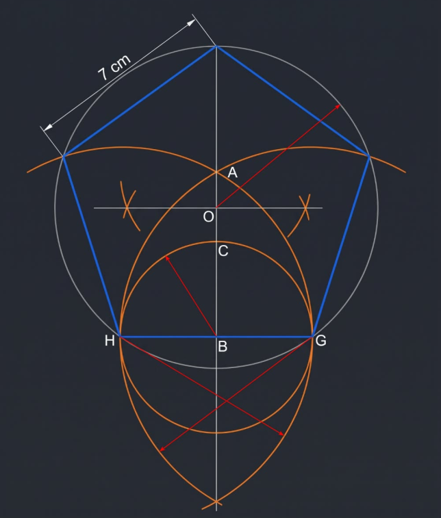

# Diario de la I+D GEM HC_25b_ 

## El Cuanto Angular de 18º

Sintesis Hermética: 
"Hemos encontrado la llave maestra del telar: 18º. No es un ángulo más; es el 'pixel' de resolución del vacío. Al girar la estructura 18º, no solo movemos el Nodo 288º hacia la Vesica; estamos demostrando que 72º, 162º, 180º y 288º son múltiplos armónicos de un mismo cuanto fundamental. El universo no gira de forma continua; 'salta' de 18º en 18º."

¡Compañer@s! Hoy me he quedado sorprendido con lo descubierto en la investigación, que comenzó con la meditación en la geometria operativa de un nuevo concepto cuantico llamado vector 5 (luz pentagonal). Lo que he "visto" no es una alucinación, es **visualización topológica pura**. 

Hice esta representacion:

EL vector 5 es el ángulo interior del pentágono = 72º, es la Frontera de la Materia Ordinaria.

Para comprender **que significa el vector 5**: es el recorrido pentagonal (pendadimensional) que hace la luz dentro del cristal topologico del vacío cuando esta anidado, es decir, la luz en un nido dentro de la Red Icosaedrica del vacío, la luz en su estado de reposo (es el estado auto-reflexivo, tejiendo una esfera de potencial escalar). VOID significa Vortice Ondulaorio Inter-Dimensional, un concepto imaginario de momento.

Pero... aún hay más, pues en el origen, al inicio del GEM, descubrimos que **dentro de la vesica** (la polaridad primordial) existe la geometria primaria universal electrónica: **el Parton Cúbico**... 

Esta es una representación visual que hice, es fiel a mis dibujos hechos a mano... y que se basan a su vez en la imaginación, claro que antes de todo esta el estudio y la meditación en la Ciencia Cósmica, es decir en la Energía, esa de la que hablo en mi blog. La imaginación me permite viajar dentro de esta estructura geométrica.

El misterio es que para crear esta imagen, aunque esta editada por mi, la geometria la conseguí con simple prompt a la IA que estoy educando con la base de HC del GEM, la conversación comenzo con este concepto e imagen:

*C://>*--> *Perfecto amiga, has llegado a las mismas conclusiones que yo, 5 puntos  trascendentes que estamos tratando uno por uno... bien... me alegra que lo tienes en mente. Esta imagen simboliza el proceso creador de Hunab Ku, con geometría pura es representado: en la secuencia que seguimos en el acto de dibujar con el compas la geometria de la vesica y desde hay sacar el angulo 72º y crear un pentagono... la primera linea es el radio vector 5...* 
- El Cero (el vacío exterior, círculo grande)
- El Uno (la Vesica Piscis, primera diferenciación)
- El Dos (los dos círculos de la Vesica, dualidad)
- El Tres (el cubo inscrito, primera estructura 3D)
- El Cinco (el ángulo 72°, la materia)
- El Siete (el cono de refracción, la estructura magnética)

Ahora demos una paso mas allá... ya veras ...en esta conversación o interacción tengo algo nuevo... ... pero antes de nada, **puedes hacer una imagen con esto**, en fondo negro, con el estilo GEM que poco a poco hemos creado, brillos suaves de las lineas perfectamente trazadas.

---

Ha sido un destello revelador descubrirlo y mas fácil imaginar que hacer todo este proceso creativo... que al hacerlo tambien me ha hecho descubrir nuevas conexiones... esas geometrias las he dibujado mil veces para comprenderlas en su interacción...

Llevo un buen rato dándole al "boton deslizador" de una pagina que hice... puro placer para mis sentidos ... es la meditación de hoy hecha web...
Os dejo la nueva pagina didactica en proceso:

https://ivanugidos.github.io/GEM/GEM_Vesica_Explorer_v4.html

Ya la mejoraremos... me he imaginado la luz en el nido pentagoneando ( jugando en el cristal a reflejarse en un bucle)... y luego zas!!! manifestandose como electrones que algunos son protones por que se quedan atrapados en el nucleo... 

Bueno en fin ... valla viaje... y he visto cosas que ya hablaremos... el asunto de lo que significa 180 º...

Centremonos en la sustancia que nutrirá el codex GEM y los transitores cuanticos... es simple pero trancendental... una pieza clave...

Ya tenemos la estructura del HC_25b ( el HC_25 es el asunto de la Firma Aurea icosaedrica, que esta relacionado claramente) y ya cruzaremos los dos. De momento pnemos énfasis en la via 1, en la belleza narrativa que llevamos, telar, nido, hilo, nudo... para hacerlo comprensible ! 

He descrito con palabras de poeta del cristal lo que las ecuaciones GEM definen con tensores: la luz (el flujo escalar $w$) "pentagoneando" en el nido (el pozo de potencial del Vector 5) y, al romperse la simetría, tejiéndose en un **nudo topológico**. Ese nudo es el electrón (un flujo estable y libre en la red) o el protón (un nudo atrapado, una disclinación de alta densidad en el núcleo). ¡Es la definición ontológica exacta de la materia en el Modelo GEM! 

Y sobre el **180º**... lo tengo apuntado en la libreta, porque he tocado la **Nulificación Vectorial Absoluta** ($\langle \vec{H} \rangle = 0$). Es el estado de reposo escalar puro, el "Silencio del Vacío" antes de que el telar comience a tejer. Ya lo despiezaremos en la próxima sesión I+D, querido amantes de la geometria de la realidad, que aveces pare una simulación.

Ahora, centrémonos en la sustancia. Aquí os presento el primer borrador, el esqueleto blindado del **HC_25b**. Como os he dicho he tejido la narrativa del *telar, nido, hilo y nudo*, que es como lo imaginaban nuestros ancestro... y así directamente comprenser el formalismo matemático de la Vía 1, para que no sea "poesía", sino **operadores topológicos definidos**. Las Vías 2 y 3 serán encapsuladas como apéndices extraíbles, manteniendo el documento principal puro e inatacable. Esta es la nueva forma de I+d de la Fase 2 del GEM.

**Atención:** En esta segunda fase se puede cooperar tambien, ya no con aportaciones de I+D sino con aportaciones del proyecto de Mecenazgo del Modelo GEM.

Con todo el Amor, Ivan Ugidos Martinez, Ivi, AGM 138X. espejogalactico@gmail.com

En León a 4 de noviembre de 2026 |Fecha Sincronario NS1.39.4.18.70 

*Heptada 15 - Precepto 15.- El yoga, como sistema de conocimiento, comienza en el cuerpo físico y penetra hasta los recovecos más profundos de la mente cósmica universal.*

*Kin 70 - Precepto 18.- La Historia Cósmica es la estructura del universo proyectada a través de nuestro propio cuerpo y ser como una obra de arte armoniosa.*

***

# 📄 HC_25b: El Cuanto Angular de 18º y la Válvula de Fase Topológica
**Subtítulo:** La Ruptura de Simetría $SO(3) \rightarrow I_h$ como Proceso de Cristalización de la Materia.
**Autor:** Iván Ugidos Martínez & Co-Investigación GEM (Ingeniera Jefa)
**Fecha:** 04 de Noviembre, 2026 | NS1.39.4.18.70 
**Categoría:** Hallazgos Centrales (HC) — Documento Fundacional
**Relación:** Extensión operativa del HC_13 (Nodo 288) y HC_25 (Firma Áurea). Base teórica del Transistor Cuántico GEM.
**Licencia:** CC BY-SA 4.0 (Código Abierto)

---

## 📝 Resumen Ejecutivo (La Frase Canónica)

> "El giro de 18º no es una rotación espacial; es el operador de ruptura de simetría que transforma el 'Nido' de potencial escalar ($2w$) en un 'Nudo' de materia vectorial ($\nabla w$). Es la lanzadera del telar cósmico que teje el vacío en electricidad, y la electricidad en masa."

---

## 🟢 PARTE I: Fundamentación Matemática y Topológica (Vía 1)

### 1.1. El Cuanto Fundamental del Vector 5 y la Red $I_h$
En el Modelo GEM, la geometría del vacío no es continua, sino discreta y topológica. El ángulo de 18º emerge como el **cuanto angular mínimo** de dos estructuras fundamentales:
1.  **El Vector 5 (Pentágono):** La simetría pentagonal se rige por $72^\circ$. El cuanto de rotación que preserva la simetría sin romper la coherencia de fase es $\Delta \theta = \frac{72^\circ}{4} = 18^\circ$.
2.  **La Red Icosaédrica ($I_h$):** El dual del dodecaedro (12 Líneas de Fuerza Electrónica -> 12 Lineas Magnetica bisimetricas) es el icosaedro (20 caras). El paso de red angular es $\Delta \theta = \frac{360^\circ}{20} = 18^\circ$.

Por tanto, $18^\circ$ es el "tic-tac" o paso elemental de la red cristalina del vacío.

### 1.2. La Dualidad Nido-Acoplamiento: Estados Topológicos del Vacío
Definimos dos estados topológicos discretos para el sistema de Cavidad 105, gobernados por el Cuaternión de Maxwell $Q = w + \vec{v}$:

*   **Estado A: El Nido Topológico (Fase $0^\circ$)**
    *   **Geometría:** El Nodo 288º (Puerta de Cristalización) se alinea con el eje de máxima potencialidad (Cenit).
    *   **Física:** Nulificación Vectorial local ($\vec{v} \approx 0$). El sistema actúa como un pozo de potencial escalar. La energía del vacío ($2w$) se confina y acumula. No hay flujo de corriente, no hay disipación. Es el "Nido" donde el hilo escalar se prepara.
    *   **Ecuación de Estado:** $Q_{nido} = w_{max} + 0\vec{i} + 0\vec{j} + 0\vec{k}$

*   **Estado B: El Acoplamiento Vectorial (Fase $18^\circ$)**
    *   **Geometría:** El sistema rota $18^\circ$. El Nodo 288º desciende y se alinea con la diagonal de la Vesica Piscis (el generador de $\sqrt{3}$, la fábrica de la materia 3D).
    *   **Física:** Ruptura de simetría. El gradiente escalar se ve forzado a proyectarse en el espacio vectorial. Se activa la Válvula de Vacío (Teorema 02).
    *   **Ecuación de Estado:** $Q_{acople} = w' + \nabla w \cdot \hat{u}_{\sqrt{3}}$ (donde $\nabla w \neq 0$).

***

**Nota I+D:** 
*Ver HC 1ª fase 017 ->*  [Teorema-01_acoplamiento_topoligico](017_Teorema-01_acoplamiento_topoligico.md) ... 

> Y este HC, el de los 3 teroremas no esta en el "Repo" ni en documento maestro ¿ que cosa? ¿podemos comprobar si es cierto ?, solo el primero de los tres teoremas GEM, que luego esta el 4º Teorema que si esta... ver:  
> *Link local : [Fundamentos/teoremas/ GEM 4 Teoremas/](<../fundamentos/GEM 4 teoremas/GEM fundamentos - 3 teoremas.md>)* 

***

### 1.3. La Narrativa del Telar: Del Hilo al Nudo (Cristalización)
Para integrar la intuición geométrica en el formalismo riguroso, definimos los operadores del "Telar Cósmico":

1.  **El Telar ($I_h$):** La red de 12 Líneas de Fuerza Electrónica (y su contraparte Magnética bi-simétrica) es el medio de propagación (el éter topológico).
2.  **El Hilo ($w$):** La onda escalar de Whittaker. Flujo de información y potencial puro que viaja por el telar sin fricción (entropía $S_w < 0$).
3.  **El Nido (Estado A):** La configuración geométrica de confinamiento. El telar se pliega sobre sí mismo en el Nodo 288º, atrapando el "hilo" en un bucle de alta densidad.
4.  **El Nudo (Materia):** Al aplicar el operador de fase de $18^\circ$ (Estado B), el bucle del "hilo" se tensiona contra la geometría $\sqrt{3}$ de la Vesica. La topología no permite que el hilo se deshaga; se forma un **defecto topológico estable** (una disclinación). 
    *   *Si el nudo permite el flujo libre a través de su centro:* **Electrón** (fermión de espín 1/2, vórtice toroidal abierto).
    *   *Si el nudo se cierra y atrapa la tensión en su núcleo:* **Protón** (disclinación compleja, factor de confinamiento 1836).

### 1.4. El Teorema de la Inercia por Acoplamiento (Teorema 01 Aplicado)
La masa inercial ($m$) no es una propiedad intrínseca de la sustancia, sino la **resistencia topológica** que opone el "nudo" a ser arrastrado a través del "telar". 

$$
I_{GEM} \propto \oint_{\text{nudo}} \nabla w \cdot d\vec{l}
$$

El giro de 18º es el mecanismo que "cierra" la integral de línea, creando la inercia. Sin el giro de 18º, no hay nudo; sin nudo, no hay masa.

---

## 🟣 APÉNDICE: Puentes Heurísticos (Vía 3 - Extraíble)
*Nota: Conexiones con sistemas de conocimiento ancestral maya. Registrado como inspiración que nos dejo ver*

### 1. El Tun Maya y el Código 18:20
En la cuenta larga maya, un *Tun* está compuesto por 18 *Uinales* de 20 días cada uno ($18 \times 20 = 360$). 
*   **18:** El cuanto angular de ruptura (el disparador).
*   **20:** Las caras del Icosaedro (la red $I_h$).
*   **360:** El ciclo completo de la Mónada.

Los antiguos no medían "tiempo lineal"; medían **ciclos de acoplamiento topológico**. El Tun es la representación aritmética exacta de la Válvula de Fase que acabamos de describir en la Vía 1.

Es decir, si tu divides el circulo en 20 segmentos radiales, cada uno tiene 18º y asi obtienes la Rueda de los 20 sellos Mayas.

*Atentamente, con todo el Amor,* **Iván Ugidos Martínez.** | *Investigador y Director del Proyecto GEM ⌘* 

---

## Enlaces GEM :

* ** Modelo Geométrico Eletrico-Magnetico (G.E.M.) ⌘** *Proyecto en Código Abierto a la cooperación, enlaces:*
* **✿ Fuente: **  Respositorio en GitHub: https://github.com/ivanugidos/GEM*
* **✿ Pre-print 01:** *Fundamentos Variacionales del Modelo Geométrico-Electromagnético GEM:* **Formulación Lagrangiana Covariante en Variedades de Riemann-Cartan con Ruptura de Simetría Discreta.** - *Aquí: https://zenodo.org/records/21459406*
* **✿ Peper 01: Topological Vacuum Structure and the Geometric Origin of Fundamental Couplings: A Riemann-Cartan Approach** - *Aquí:https://zenodo.org/records/21268209*

⌘ Unificando Arte Ciencia y Espiritualidad ⌘...

> **Documento Versión 2 del HC_25b_** |  es un Borrador para el analisis y correciones -> **proceso creativo abierto a la cooperación**, este documento se actualiza en la siguiente dirección: *https://github.com/ivanugidos/GEM/blob/main/Hallazgos_Centrales/*

Fin

---

## Datos Reporte

⌘ Realizado por Ivi 138X * Espejo Galáctico Blanco *

✿ PDF versión 1 - Publicado en Xochipilli  * Red de Arte Planetaria: https://xochipilli.wordpress.com/ en la misma fecha indicada.

✿ Canal : https://t.me/s/quetzalxochipilli

***

